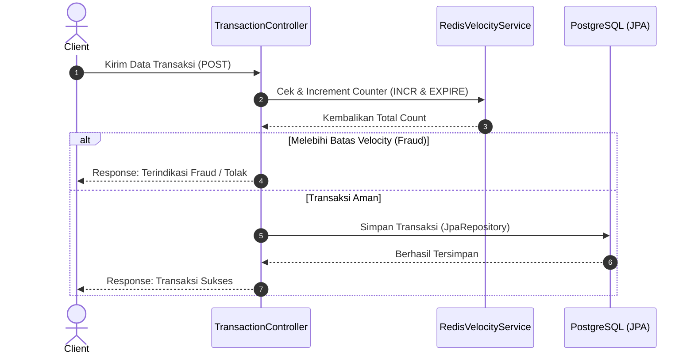
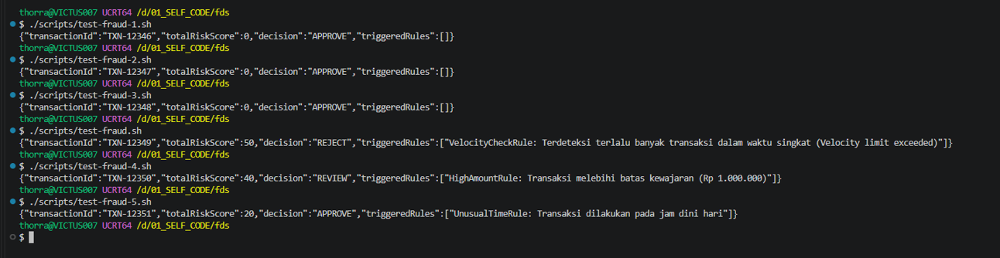
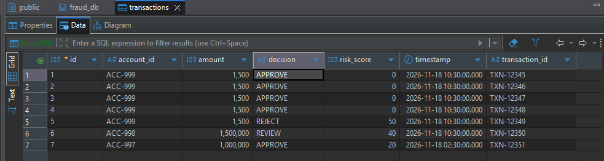
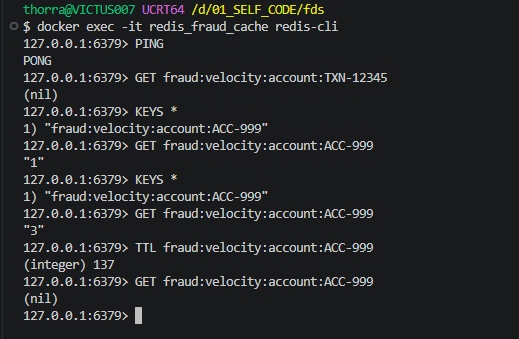

# Fraud Detection System (FDS)

Sistem backend berbasis Spring Boot untuk mendeteksi potensi transaksi penipuan (*fraud*) secara *real-time* menggunakan kombinasi basis data relasional dan *in-memory cache*.

## 🚀 Tech Stack
- **Java 21**
- **Spring Boot 3.x**
- **Spring Data JPA & PostgreSQL** (Persistence & Migrasi via Flyway)
- **Spring Data Redis / StringRedisTemplate** (Velocity & Rate Limiting Check)

---




## 📝 Penjelasan Alur Sistem
1. **Penerimaan Request:** Endpoint menerima data transaksi melalui REST API (`POST /api/transactions`).
2. **Pengecekan Kecepatan (*Velocity Check*):** 
   - Layanan `RedisVelocityService` menggunakan `StringRedisTemplate` untuk menaikkan penghitung (`INCR`) berdasarkan `accountId`.
   - Jika ini transaksi pertama dalam jendela waktu tersebut, TTL (*Time-To-Live*) langsung dipasang.
3. **Evaluasi Aturan (*Rule Engine*):** Sistem mengecek apakah jumlah transaksi (`currentCount`) melewati batas maksimal yang diizinkan (`maxAllowed`).
4. **Penyimpanan Data (*Persistence*):** 
   - Struktur database dikelola secara otomatis menggunakan migrasi **Flyway**.
   - Jika transaksi lolos atau dicatat sebagai data riwayat, data disimpan secara permanen ke **PostgreSQL** melalui `TransactionRepository`.

---

## ⚙️ Konfigurasi (application.yml)
Pastikan Anda mengatur konfigurasi database dan Redis pada `src/main/resources/application.yml`:

```yaml
spring:
  datasource:
    url: jdbc:postgresql://localhost:5432/fds_db
    username: postgres
    password: secret
  data:
    redis:
      host: localhost
      port: 6379
      
```

## 🏃 Cara Menjalankan Proyek
- Clone repository ini.

- Pastikan layanan PostgreSQL dan Redis sudah aktif (bisa via Docker Compose).

- Jalankan perintah Maven berikut untuk memulai aplikasi:
```mvn spring-boot:run ```

## 🧪 Contoh Pengujian API
Kirimkan request POST ke endpoint transaksi untuk menguji aturan validasi:

```
curl -X POST http://localhost:8080/api/v1/transactions \
-H "Content-Type: application/json" \
-d '{
  "transactionId": "TXN-12349",
  "accountId": "ACC-999",
  "amount": 1500.00,
  "currency": "USD",
  "timestamp": "2026-11-18T10:30:00",
  "ipAddress": "192.168.1.10",
  "deviceId": "device-xyz-01"
}'
```

## Hasil Pengujian
- Response Api Ketika di Hit oleh 5 transaksi



- Pengecekan data yang terbentuk di database PostgreSql



- Pengecekan data yang terbentuk di Redis 



